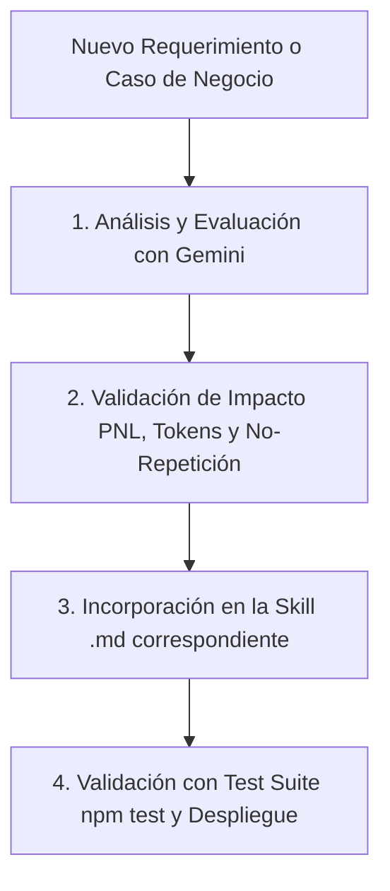

# Protocolo de Gestión y Evolución de Skills (MATEO - RED NITROX)

Este directorio contiene las habilidades e instrucciones modulares del agente **MATEO**, cargadas en memoria RAM por `skill_loader.js` para alimentar a **Gemini Brain** en tiempo real con cero latencia de disco.

---

## 📌 Regla Suprema de Incorporación de Nuevas Cosas / Requerimientos

> **"CUANDO SEAN COSAS NUEVAS LAS PASAS POR GEMINI Y DESPUÉS LO METES A LAS SKILL"**

Cada vez que surja un nuevo requerimiento, regla de negocio, ajuste conversacional, nuevo producto o caso especial, se debe seguir estrictamente este flujo de 4 pasos:

### 1. Análisis y Evaluación Previa con Gemini:
- No se agrega directamente texto improvisado a las skills.
- Se procesa el nuevo caso por **Gemini** para:
  - Formular la regla con lenguaje natural óptimo y de alto impacto.
  - Asegurar coherencia con los principios de Programación Neurolingüística (PNL) y tono paisa/colombiano ("con chispa", sin "hermano", sin muletillas).
  - Validar que no aumente el consumo innecesario de tokens ni genere latencia.

### 2. Clasificación en la Skill Modular Correcta:
- **Identidad, estilo y PNL** ➔ `00_identidad_pnl.md`
- **Primer contacto, saludo y presentación** ➔ `01_saludo_presentacion.md`
- **Datos del taller, ubicación y preguntas enfáticas** ➔ `02_vinculacion_taller.md`
- **Quejas, reclamos, corrección de nombres e insultos** ➔ `03_manejo_friccion.md`
- **Marca NITROX, catálogo y recomendaciones comerciales** ➔ `04_asesoria_comercial_nitrox.md`
- **Cédula, correo, Habeas Data y entrega de carnet** ➔ `05_cierre_habeas_data.md`
- **Estructura JSON de entrada/salida** ➔ `06_output_schema.md`
- *(Si es un dominio completamente nuevo, se crea un nuevo archivo con prefijo secuencial, ej: `07_nuevo_dominio.md`)*.

### 3. Prueba y Validación Automatizada:
- Se añade o actualiza el caso de prueba en `test/cerebro_mateo.test.js`.
- Se ejecuta `npm test` verificando el 100% de cumplimiento.
- Se compila y despliega en Cloud Run.
